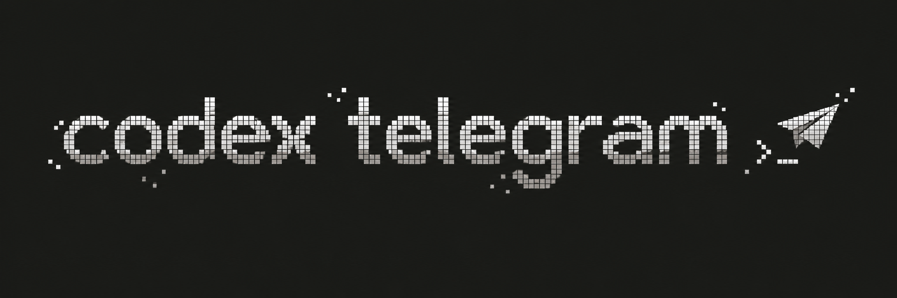
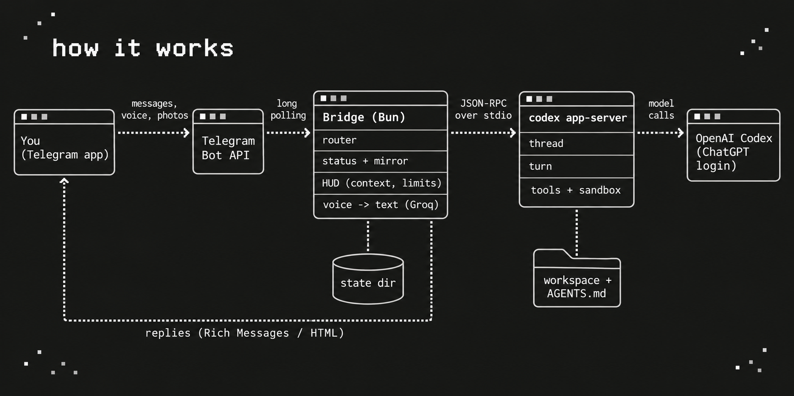

<p align="center"><picture><source media="(prefers-color-scheme: dark)" srcset="docs/images/banner-dark.png"><source media="(prefers-color-scheme: light)" srcset="docs/images/banner-light.png"></picture></p>

# Codex CLI Telegram Plugin

> **Read in your language:** English (this page) · [**Русская версия →**](README.ru.md)

> **По-русски:** личный агент OpenAI Codex в приватном чате Telegram, на вашем сервере и с вашим входом ChatGPT.

[](LICENSE)
[](https://bun.com/docs/installation)
[](https://developers.openai.com/codex/cli)
[](#requirements)
[](#license-and-credits)

**Releases:** [GitHub releases](https://github.com/qwwiwi/codex-cli-telegram-plugin/releases) · current: v0.1.0 (pre-release), [release notes](RELEASE_NOTES_v0.1.0.md) · [CHANGELOG.md](CHANGELOG.md)

## Your own Codex agent in a private Telegram chat.

**A small Bun/TypeScript bridge between a Telegram bot and OpenAI Codex CLI.** It starts `codex app-server` (the JSON-RPC interface of Codex CLI) as a child process, forwards your messages to a Codex conversation and sends the answers back to the chat. One bot serves one owner, in a private chat, on your own server, with your own ChatGPT login.

- **Plain chat.** Text, voice, photos, documents and albums go to Codex; answers come back formatted.
- **Long tasks.** `/goal` keeps Codex working towards a stated result; you see a live status line and milestones while it runs.
- **Control.** Approval cards for actions outside the sandbox, or a fully autonomous mode for a dedicated OS user.
- **Context at a glance.** An optional pinned card (HUD) with context use, plan and Codex rate limits.
- **No lost messages.** Messages, the Codex thread and delivery progress are saved on disk and survive a restart.

<p align="center"></p>

---

## Quick start

The installer targets Linux with systemd. Run every step as the ordinary (non-root) user that will own the bot.

**1. Prepare the tools.** Install `git`, `curl`, `jq`, then [Bun](https://bun.com/docs/installation) and [Codex CLI](https://developers.openai.com/codex/cli). Check `bun --version` and `codex --version`.

**2. Sign in to Codex** with your ChatGPT account (device code flow, works on a server without a browser):

```bash
codex login --device-auth
codex login status
```

**3. Create a bot.** In Telegram open @BotFather, send `/newbot` and keep the token. Open the private chat of the new bot and press **Start**. See [Telegram bot features](https://core.telegram.org/bots/features#botfather).

**4. Install and start:**

```bash
git clone https://github.com/qwwiwi/codex-cli-telegram-plugin && cd codex-cli-telegram-plugin
./install.sh --start
```

The installer asks for the token (hidden input), prints a one-time code and asks you to send it to the bot; this proves which Telegram account is the owner. It writes a private `plugin/.env`, creates the workspace (default `~/krotov-workspace`) with a starter `AGENTS.md`, the state directory (default `~/.local/state/krotov-plugin`), runs `bun run doctor` and enables the user service `krotov-telegram.service`.

**5. First message.** Send `/help` to the bot, then any question. The bot reacts with an eyes emoji when it receives a message.

| `install.sh` flag | Meaning |
|---|---|
| `--start` | enable and start the user service after a green `doctor` |
| `--agent-name NAME` | agent name in status and greetings (default: the bot's name) |
| `--workspace PATH` | Codex working folder (absolute path) |
| `--state-dir PATH` | bridge state folder, must be outside the workspace |
| `--approval-mode standard\|risky` | how approval cards are filtered (see [Security](#security-model)) |
| `--non-interactive --token-file PATH` | no prompts; token from a private file |
| `--owner-id ID` / `--pair-code CODE` | owner by numeric ID, or by a pre-sent `krotov-<uuid>` code |
| `--dry-run` | print the plan and exit |

Manual setup on Ubuntu or Debian: [plugin/docs/quickstart.md](plugin/docs/quickstart.md). Setup by an AI agent: [INSTALL-WITH-AGENT.md](INSTALL-WITH-AGENT.md). On macOS there is no installer and no systemd unit; set `plugin/.env` by hand and run `bun run start` in `plugin/`.

---

## Requirements

- Linux with systemd user services for `install.sh` and `update.sh`; `loginctl enable-linger` so the bot keeps running after you log out.
- `bun`, `codex`, `git`, `flock`, `curl`, `jq` in `PATH` (checked by the installer).
- A ChatGPT account with Codex access. The bridge checks at start that Codex is signed in through ChatGPT.
- A Telegram bot token from BotFather with no webhook set.
- Optional: a Groq API key for voice messages.

## Features

- One owner, one private chat; everything else is ignored.
- Text, voice (transcribed), photos, documents, albums, forwards and replies with quoted context.
- A live status message while Codex works, moved below new messages so it stays visible.
- `/mirror on` shows a compact live feed of commands Codex runs.
- Approval cards for commands, file changes and MCP tool calls; question cards when Codex asks you to choose.
- `/goal` for long tasks with a completion criterion; unfinished tasks continue in the next turn.
- Optional pinned HUD: context window use, model, plan, autonomy mandate, Codex limits; moves to the bottom after each turn.
- Optional parallel answers: a new question while a long task runs gets its own side conversation.
- Saved conversations: `/cc resume`, export to a file, model choice.
- Optional learning memory (`/memory`), see [plugin/docs/learning.md](plugin/docs/learning.md).

## Voice messages

Set `GROQ_API_KEY` in `plugin/.env`. A voice message is downloaded and sent to the Groq transcription endpoint (`whisper-large-v3-turbo`, language `ru` by default, files up to 25 MB). Codex receives the text. Without a key, or when transcription fails, Codex receives a note that the transcript is unavailable plus the path to the downloaded file.

## How replies are formatted

Codex writes Markdown. The bridge first tries a **Rich Message**: Telegram's `sendRichMessage`, which renders Markdown on Telegram's side, one message up to 32768 bytes. It is used when the reply has no files, fits the limit and has no expandable quote. If Telegram rejects rich messages, the bridge switches them off for the rest of the process and uses the **HTML fallback**: Markdown converted to Telegram HTML and split into 4096-character parts; on an HTML parse error the part is resent as plain text. Turn rich messages off with `TELEGRAM_RICH_MESSAGES=0`.

## Commands

| Command | What it does |
|---|---|
| `/help` | list of commands |
| `/status` | session state, current step, model, context use, queue, mirror and approval state |
| `/stop` | interrupt the current turn (and parallel side turns) |
| `/new` | start a new Codex conversation; stops a running task first |
| `/reset force` | start a new conversation when nothing runs (`/reset` alone asks for `force`) |
| `/compact` | compress the Codex conversation context |
| `/keys` | inline buttons: status, stop, compact, help |
| `/mirror on\|off\|status` | live feed of Codex commands |
| `/lease <task>[; ttl=48h]`, `/lease revoke <ID>`, `/lease consume <ID>` | give, list or revoke an autonomy mandate |
| `/cc` | `compact`, `context`, `status`, `model [name]`, `resume [number or ID]`, `export`, `cost`, `clear` |
| `/goal <result>` | set a long goal; `/goal`, `/goal status`, `/goal pause`, `/goal resume`, `/goal cancel` |
| `/memory` | learning suggestions and skills; only with `KROT_CODEX_LEARNING=1` |
| `/pin`, `/unpin` | pin or unpin the message you reply to |
| `/react <emoji>` | put a reaction on the message you reply to |
| `/edit <text>` | replace the text of a bot message you reply to |
| `/get` | hand an attachment from the quoted message to Codex |

`/help`, `/status`, `/stop`, `/reset` and `/new` can be switched off in `config.json` (`commands` block). Unknown `/cc <name>` commands are read from `KROT_CODEX_COMMANDS_DIR` when it is set.

## Security model

- **Single owner.** The bridge refuses to start unless exactly one user ID and the same private chat ID are allowed. Messages from anyone else, from groups and from bots are dropped.
- **Never root.** The bridge exits when started as root, and the installer refuses to run as root. Run it under a dedicated unprivileged OS user that has no access to your other data.
- **Secrets stay out of Codex.** Codex gets only an allowlist of environment variables (`PATH`, `HOME`, locale, `CODEX_HOME`, `GH_CONFIG_DIR` and a few system ones). The bot token and the Groq key are not passed and are redacted from logs and messages.
- **State outside the workspace.** The state directory must be outside the Codex workspace, so Codex cannot edit the bridge's own files.

Approval modes:

| Setting | Codex behaviour | When to use |
|---|---|---|
| `KROT_CODEX_APPROVALS=1` (set by the installer) | sandbox `workspace-write`, approval policy `on-request`: Codex asks before actions outside the sandbox; you get a card with the exact command or diff | default for a personal agent |
| `KROT_CODEX_APPROVALS=1` + `KROT_CODEX_APPROVAL_MODE=risky` | as above, but routine requests are decided by the bridge's policy and only risky or unclear ones reach you | when cards come too often |
| `KROT_CODEX_APPROVALS` unset, or `KROT_CODEX_APPROVAL_MODE=never` | sandbox `workspace-write`, policy `never`: no approval cards of any kind (commands, files, MCP and GitHub connector calls); actions that need approval fail | read-and-write inside the workspace only |
| `KROT_CODEX_SANDBOX=danger-full-access`, `KROT_CODEX_APPROVALS` unset | no sandbox, no cards: Codex can use the network and write anywhere the OS user can | only for a dedicated unprivileged OS user on a machine you can rebuild |

`danger-full-access` cannot be combined with `KROT_CODEX_PROXY`.

## Parallel answers

Off by default. With `KROT_CODEX_PARALLEL=1`, a new message that arrives while the main task runs is routed like this:

1. A reply to a message of a side conversation continues that side conversation.
2. Any other reply goes into the running main task as a correction.
3. A message that starts with a correction word goes into the main task. Default words: `уточнение`, `поправка`, `к задаче`, `стоп`; override with `KROT_CODEX_CORRECTION_WORDS` (comma-separated).
4. Anything else starts a side conversation in the same app-server, if fewer than `KROT_CODEX_MAX_PARALLEL` conversations run (main included, default 2, max 8). Otherwise the message waits in the queue and the bot tells you what is running.

Side conversations do not touch the main conversation, the HUD or the status message. `/stop` stops them too.

## Configuration

Settings live in `plugin/.env` (environment) and an optional `config.json` in the state directory; the environment wins. The installer writes the required ones: `TELEGRAM_BOT_TOKEN`, `TELEGRAM_EXPECTED_BOT_ID`, `TELEGRAM_ALLOWED_USER_IDS`, `TELEGRAM_ALLOWED_CHAT_IDS`, `TELEGRAM_STATE_DIR`, `TELEGRAM_WORKSPACE_ROOT`, `KROT_CODEX_AGENT_NAME`, `KROT_CODEX_APPROVALS`. Commonly added: `TELEGRAM_HUD_ENABLED=1`, `GROQ_API_KEY`, `KROT_CODEX_MODEL`, `KROT_CODEX_SANDBOX`, `KROT_CODEX_PARALLEL=1`. Every variable is listed in [docs/ARCHITECTURE.md](docs/ARCHITECTURE.md#configuration-and-environment). Restart the service after a change.

## Update and uninstall

Update (fast-forward from the upstream branch, tests and `doctor` run on a staged copy first):

```bash
./update.sh            # then restart when the bot is idle
./update.sh --restart  # restart right away
```

Uninstall:

```bash
systemctl --user disable --now krotov-telegram.service
rm ~/.config/systemd/user/krotov-telegram.service
systemctl --user daemon-reload
```

Then delete the clone, the state directory and, if you no longer need it, the workspace.

## Troubleshooting

| Symptom | Cause and fix |
|---|---|
| Installer says Telegram did not confirm the token, though the token is right | The command ran without network access, for example inside a Codex sandbox. Run `./install.sh` from a normal shell. |
| Installer or `doctor` reports an active webhook | The bridge uses long polling (`getUpdates`); Telegram does not deliver updates by polling while a webhook is set. Use a new bot or remove the webhook from the other integration. |
| Bot stops answering, log shows `409 Conflict` | Another process polls the same token. Stop it; only one poller per token works. |
| A restart killed a running task | A restart stops the Codex process and its current turn; nothing resumes mid-turn. On start the bridge looks up the final answer of the interrupted task and delivers it, or tells you the result could not be restored. Queued messages continue. Restart only when the bot is idle (`update.sh` without `--restart`, then restart yourself). |
| `/help` works, ordinary messages get no answer | Check `codex login status` as the service user and `journalctl --user -u krotov-telegram.service -n 50`. |

Run `bun run doctor` in `plugin/` to check the environment at any time.

## Documentation

- [docs/ARCHITECTURE.md](docs/ARCHITECTURE.md): code map, message flow, state files, cards, HUD, all environment variables
- [plugin/docs/quickstart.md](plugin/docs/quickstart.md): manual installation on a VPS (Russian)
- [plugin/docs/install.md](plugin/docs/install.md): deployment guide and Telegram commands
- [plugin/docs/root-backend.md](plugin/docs/root-backend.md): separate Codex App Server through a local relay
- [plugin/docs/learning.md](plugin/docs/learning.md): learning memory
- [CHANGES.md](CHANGES.md): changes in this fork

Developer tests: `bun test` in `plugin/`.

## License and credits

Based on Krotov-plugin by Pavel Krotov ([github.com/PashaKrot](https://github.com/PashaKrot)), Apache-2.0. This fork adds, on top of upstream commit `bb1d1ce`:

- Codex limits line in the HUD
- `GH_CONFIG_DIR` passthrough to Codex
- HUD moves to the bottom of the chat after each turn
- autonomous sandbox mode without approval cards (`KROT_CODEX_SANDBOX`)
- deletion of the bot's own pin service messages
- parallel answers while a task runs (`KROT_CODEX_PARALLEL`)

Details and dates: [CHANGES.md](CHANGES.md). License: [Apache-2.0](LICENSE), notices: [NOTICE](NOTICE). Modifications by Dashi Eshiev (qwwiwi) and contributors. Issues and PRs welcome.
