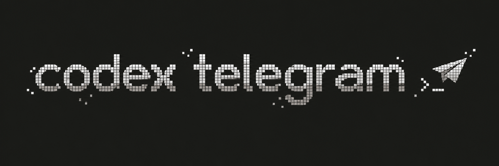
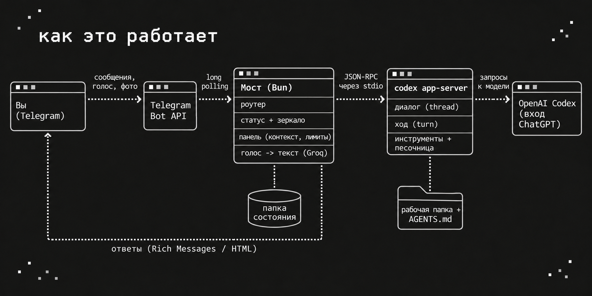

<p align="center"><picture><source media="(prefers-color-scheme: dark)" srcset="docs/images/banner-dark.png"><source media="(prefers-color-scheme: light)" srcset="docs/images/banner-light.png"></picture></p>

# Codex CLI Telegram Plugin

> **Читать на своём языке:** [English →](README.md) · Русская версия (эта страница)

[](LICENSE)
[](https://bun.com/docs/installation)
[](https://developers.openai.com/codex/cli)
[](#что-нужно)
[](#лицензия-и-авторы)

**Релизы:** [GitHub releases](https://github.com/qwwiwi/codex-cli-telegram-plugin/releases) · сейчас v0.1.0 (pre-release), [заметки к релизу](RELEASE_NOTES_v0.1.0.md) · [CHANGELOG.md](CHANGELOG.md)

## Свой агент Codex в личке Telegram.

**Это небольшая программа-мост между вашим Telegram-ботом и Codex CLI от OpenAI.** Вы пишете боту, мост передаёт сообщение Codex, Codex выполняет работу на вашем сервере, а ответ приходит обратно в чат. Один бот служит одному владельцу, только в личке, на вашем сервере и с вашим входом в ChatGPT.

- **Обычный чат.** Текст, голосовые, фото, документы и альбомы уходят в Codex, ответы приходят с форматированием.
- **Долгие задачи.** `/goal` держит Codex в работе до заявленного результата; пока он работает, видно статус и промежуточные вехи.
- **Контроль.** Карточки подтверждения для действий за пределами песочницы или полностью автономный режим для отдельного пользователя системы.
- **Всё видно сразу.** По желанию закреплённая карточка (HUD) с заполнением контекста, планом и лимитами Codex.
- **Сообщения не теряются.** Очередь, диалог Codex и ход доставки сохраняются на диске и переживают перезапуск.

<p align="center"></p>

---

## Несколько слов о терминах

- **Codex CLI** — программа OpenAI для работы с Codex в терминале. Её нужно установить на сервер.
- **app-server** — режим Codex CLI (`codex app-server`), в котором им управляет другая программа, а не человек. Мост запускает его сам.
- **JSON-RPC** — формат, в котором мост и app-server обмениваются сообщениями: запрос, ответ, уведомление.
- **Песочница (sandbox)** — ограничения, в которых Codex запускает команды: например, писать можно только в рабочую папку.
- **Polling** — способ получать сообщения: мост сам регулярно спрашивает Telegram, нет ли новых. Отдельный сайт или открытый порт не нужен.
- **HUD** — закреплённое сообщение в чате, где видно, сколько контекста занято, какая модель, план и лимиты.
- **Рабочая папка (workspace)** — папка на сервере, где Codex работает с файлами. В ней лежит `AGENTS.md` — инструкция для вашего агента.

## Быстрый старт

Установщик рассчитан на Linux с systemd (Ubuntu, Debian). Все шаги выполняйте под обычным пользователем, не под `root`. Лучше завести отдельного пользователя только для бота.

**1. Подготовьте инструменты.** Установите `git`, `curl`, `jq`, затем [Bun](https://bun.com/docs/installation) и [Codex CLI](https://developers.openai.com/codex/cli). Проверьте, что обе команды работают:

```bash
bun --version
codex --version
```

**2. Войдите в Codex** своим аккаунтом ChatGPT. Команда покажет ссылку и код: откройте ссылку в браузере на своём компьютере и введите код. Так вход работает даже на сервере без браузера.

```bash
codex login --device-auth
codex login status
```

**3. Создайте бота.** В Telegram откройте @BotFather, отправьте `/newbot`, задайте имя и имя пользователя бота. Сохраните токен, который выдаст BotFather: это пароль бота, никому его не показывайте. Откройте личку нового бота и нажмите **Start**. Подробнее: [документация Telegram](https://core.telegram.org/bots/features#botfather).

**4. Установите и запустите мост:**

```bash
git clone https://github.com/qwwiwi/codex-cli-telegram-plugin && cd codex-cli-telegram-plugin
./install.sh --start
```

Что сделает установщик:

1. Спросит токен бота (ввод скрыт).
2. Покажет одноразовый код и попросит отправить его боту в личку. Так он узнаёт, кто владелец.
3. Сохранит настройки в приватный файл `plugin/.env`.
4. Создаст рабочую папку (по умолчанию `~/krotov-workspace`) со стартовым `AGENTS.md` и папку состояния (по умолчанию `~/.local/state/krotov-plugin`).
5. Запустит проверку `bun run doctor`.
6. Включит службу `krotov-telegram.service`, чтобы бот работал и после перезагрузки сервера.

**5. Первое сообщение.** Отправьте боту `/help`, потом любой вопрос. Бот показывает, что работает над сообщением; иногда агент сам ставит на сообщение подходящую по смыслу реакцию (`KROT_ACK_REACTION=off`, установщик записывает это сам, и так же работает обновлённая установка без этой строки; `KROT_ACK_REACTION=eyes` ставит 👀 на каждое сообщение, как в старых версиях).

Параметры `install.sh`:

| Параметр | Что делает |
|---|---|
| `--start` | включить и запустить службу после успешной проверки |
| `--agent-name ИМЯ` | имя агента в статусе и приветствиях (по умолчанию имя бота) |
| `--workspace ПУТЬ` | рабочая папка Codex (абсолютный путь) |
| `--state-dir ПУТЬ` | папка состояния моста, обязательно вне рабочей папки |
| `--approval-mode never\|standard\|risky` | карточки подтверждения: `never` (по умолчанию для новой установки, автономно, без карточек), `standard` или `risky` (см. [Безопасность](#безопасность)) |
| `--non-interactive --token-file ПУТЬ` | без вопросов, токен из приватного файла |
| `--owner-id ID` / `--pair-code КОД` | владелец по числовому ID или по заранее отправленному коду `krotov-<uuid>` |
| `--dry-run` | показать план и выйти |

Ручная установка на Ubuntu или Debian: [plugin/docs/quickstart.md](plugin/docs/quickstart.md). Установка силами ИИ-агента: [INSTALL-WITH-AGENT.md](INSTALL-WITH-AGENT.md). На macOS установщика и службы нет: заполните `plugin/.env` вручную и запустите `bun run start` в папке `plugin/`.

---

## Что нужно

- Linux с пользовательскими службами systemd — для `install.sh` и `update.sh`. Чтобы бот работал после выхода из терминала, нужен `loginctl enable-linger` (установщик подскажет).
- Команды `bun`, `codex`, `git`, `flock`, `curl`, `jq` (установщик их проверяет).
- Аккаунт ChatGPT с доступом к Codex. При старте мост проверяет, что Codex вошёл через ChatGPT.
- Токен бота от BotFather. У бота не должно быть настроенного webhook.
- По желанию: ключ Groq для голосовых сообщений.

## Что умеет

- Один владелец, одна личка; всё остальное мост игнорирует.
- Текст, голосовые (с расшифровкой), фото, документы, альбомы, пересланные сообщения и ответы с цитатой.
- Живой статус, пока Codex работает. Статус переезжает под новые сообщения, чтобы его было видно.
- Видно, о чём думает агент: вместо неподвижного `reasoning...` статус показывает последнюю строку размышлений Codex (краткое содержание его рассуждений). Включено в новой установке; выключить — `TELEGRAM_STATUS_THOUGHTS=0`.
- `/mirror on` показывает короткую живую ленту команд, которые выполняет Codex.
- Карточки подтверждения для команд, изменений файлов и вызовов MCP-инструментов. Карточки-вопросы, когда Codex просит выбрать вариант.
- `/goal` для долгих задач с критерием готовности. Незаконченная задача продолжается в следующем ходе.
- По желанию — закреплённый HUD: контекст, модель, план, мандат автономии, лимиты Codex. После каждого хода он переезжает вниз чата.
- По желанию — параллельные ответы: новый вопрос во время долгой задачи получает свой отдельный диалог.
- Ответы-виджеты: цифры, графики, шаги, планы и сравнения Codex может показать виджетом Telegram из [html-components](https://github.com/qwwiwi/html-components); если виджет не показать, те же данные приходят текстом.
- Сохранённые диалоги: `/cc resume`, выгрузка в файл, выбор модели.
- По желанию — память уроков и навыков (`/memory`), см. [plugin/docs/learning.md](plugin/docs/learning.md).

## Голосовые сообщения

Добавьте `GROQ_API_KEY` в `plugin/.env` и перезапустите службу. Мост скачивает голосовое и отправляет его на расшифровку в Groq (модель `whisper-large-v3-turbo`, язык по умолчанию `ru`, файлы до 25 МБ). Codex получает уже текст. Без ключа или при ошибке расшифровки Codex получает пометку, что расшифровки нет, и путь к скачанному файлу.

## Как оформляются ответы

Codex пишет ответ в Markdown — это простая разметка: `**жирный**`, списки, таблицы.

- **Rich Message.** Сначала мост пробует отправить ответ через `sendRichMessage`: Telegram сам отображает Markdown, одно сообщение до 32768 байт. Так уходят ответы без файлов, которые помещаются в лимит, не содержат сворачиваемой цитаты и содержат то, что показывает только Telegram: таблицу, формулу, список задач, `<details>` или сноску. Обычный текст уходит через HTML: в Rich Message Telegram ставит абзацы без пустой строки между ними.
- **Запасной путь — HTML.** Если Telegram отказывает в Rich Messages, мост отключает их до перезапуска. Тогда Markdown переводится в HTML для Telegram и режется на части до 4096 символов. Если Telegram не принял HTML, часть уходит простым текстом.

Отключить Rich Messages: `TELEGRAM_RICH_MESSAGES=0`.

## Команды

| Команда | Что делает |
|---|---|
| `/help` | список команд |
| `/status` | состояние сессии, текущий этап, модель, контекст, очередь, зеркало и подтверждения |
| `/stop` | прервать текущую задачу (и параллельные) |
| `/new` | начать новый диалог Codex; работающая задача сначала останавливается |
| `/reset force` | начать новый диалог, когда ничего не выполняется (`/reset` без `force` попросит подтверждение) |
| `/compact` | сжать контекст диалога Codex |
| `/keys` | кнопки: статус, стоп, сжать, справка |
| `/mirror on\|off\|status` | живая лента команд Codex |
| `/lease <задача>[; ttl=48h]`, `/lease revoke <ID>`, `/lease consume <ID>` | выдать, посмотреть или отозвать мандат автономии |
| `/cc` | `compact`, `context`, `status`, `model [имя]`, `resume [номер или ID]`, `export`, `cost`, `clear` |
| `/goal <результат>` | поставить длинную цель; `/goal`, `/goal status`, `/goal pause`, `/goal resume`, `/goal cancel` |
| `/memory` | предложения памяти и навыки; только при `KROT_CODEX_LEARNING=1` |
| `/pin`, `/unpin` | закрепить или открепить сообщение, на которое вы ответили |
| `/react <эмодзи>` | поставить реакцию на сообщение, на которое вы ответили |
| `/edit <текст>` | заменить текст сообщения бота, на которое вы ответили |
| `/get` | передать Codex вложение из процитированного сообщения |
| `/doctor` | самопроверка: запускает `doctor`, получает версию с GitHub (`KROT_UPDATE_REMOTE`, по умолчанию `public`, если он есть, иначе `origin`; `KROT_UPDATE_BRANCH`, по умолчанию `main`) и сообщает, на сколько коммитов мост отстаёт или опережает, какие файлы изменены локально (только имена), совпадают ли `bun.lock` и `node_modules`, версию Codex CLI и [журнал ошибок](#журнал-ошибок) (сколько ошибок за 24 часа и 7 дней, последние 5); `/doctor fix` передаёт отчёт Codex, чтобы он исправил безопасное, не перезапуская мост посреди ответа |

`/help`, `/status`, `/stop`, `/reset` и `/new` можно выключить в `config.json` (блок `commands`). Если задан `KROT_CODEX_COMMANDS_DIR`, неизвестные команды `/cc <имя>` берутся из этой папки.

## Безопасность

- **Один владелец.** Мост не запустится, если разрешён не ровно один пользователь и не его личный чат. Сообщения от других людей, из групп и от ботов отбрасываются.
- **Никогда не под root.** Под `root` мост сразу завершается, установщик тоже отказывается работать. Запускайте бота под отдельным непривилегированным пользователем системы, у которого нет доступа к вашим остальным данным.
- **Секреты не попадают в Codex.** Codex получает только разрешённый список переменных окружения (`PATH`, `HOME`, язык, `CODEX_HOME`, `GH_CONFIG_DIR` и несколько системных). Токен бота и ключ Groq ему не передаются и вырезаются из логов и сообщений.
- **Состояние вне рабочей папки.** Папка состояния обязана быть вне рабочей папки, чтобы Codex не мог изменить файлы самого моста.
- **Размышления очищаются от секретов.** Строки размышлений в статусе проходят ту же очистку, что и строки команд: заданные секреты, токены, ключи и похожие значения скрываются, а слово, которое ещё дописывается, не показывается, пока не допишется целиком, — поэтому половина секрета не появится. Они живут только во временном сообщении статуса, которое удаляется в конце ответа.

Режимы подтверждений:

| Настройка | Как ведёт себя Codex | Когда подходит |
|---|---|---|
| `KROT_CODEX_APPROVALS=1` + `KROT_CODEX_APPROVAL_MODE=never` (ставит установщик) или `KROT_CODEX_APPROVALS` не задан | песочница `workspace-write`, политика `never`: карточек нет совсем, агент не ждёт вашего ответа, действия за пределами песочницы не выполняются | по умолчанию: автономный агент внутри рабочей папки |
| `KROT_CODEX_APPROVALS=1` + `KROT_CODEX_APPROVAL_MODE=standard` (`--approval-mode standard`) | песочница `workspace-write`, политика `on-request`: перед действием за пределами песочницы Codex спрашивает; вы видите карточку с точной командой или изменением файла | когда хотите подтверждать действия за пределами рабочей папки |
| `KROT_CODEX_APPROVALS=1` + `KROT_CODEX_APPROVAL_MODE=risky` | как `standard`, но простые запросы на чтение мост одобряет сам, а до вас доходят рискованные и неясные | когда карточек слишком много |
| `KROT_CODEX_SANDBOX=danger-full-access`, `KROT_CODEX_APPROVALS` не задан | без песочницы и без карточек: Codex ходит в сеть и пишет везде, куда может пользователь системы | только для отдельного непривилегированного пользователя на сервере, который не жалко переустановить |

`danger-full-access` нельзя совмещать с `KROT_CODEX_PROXY`.

## Параллельные ответы

По умолчанию выключены. С `KROT_CODEX_PARALLEL=1` новое сообщение, пришедшее во время работы над задачей, распределяется так:

1. Ответ на сообщение из побочного диалога продолжает этот побочный диалог.
2. Любой другой ответ (через «Ответить») уходит в текущую задачу как уточнение.
3. Сообщение, которое начинается со слова-уточнения, уходит в текущую задачу. По умолчанию это `уточнение`, `поправка`, `к задаче`, `стоп`; свои слова через запятую задаются в `KROT_CODEX_CORRECTION_WORDS`.
4. Всё остальное открывает побочный диалог в том же app-server, если сейчас работает меньше `KROT_CODEX_MAX_PARALLEL` диалогов (вместе с основным, по умолчанию 2, максимум 8). Иначе сообщение ждёт в очереди, а бот сообщает, что сейчас выполняется.

Побочные диалоги не трогают основной диалог, HUD и статус. `/stop` останавливает и их.

## Настройки

Настройки лежат в `plugin/.env` (переменные окружения) и в необязательном `config.json` в папке состояния; переменные окружения важнее. Установщик сам записывает обязательные: `TELEGRAM_BOT_TOKEN`, `TELEGRAM_EXPECTED_BOT_ID`, `TELEGRAM_ALLOWED_USER_IDS`, `TELEGRAM_ALLOWED_CHAT_IDS`, `TELEGRAM_STATE_DIR`, `TELEGRAM_WORKSPACE_ROOT`, `KROT_CODEX_AGENT_NAME`, `KROT_CODEX_APPROVALS`, `KROT_CODEX_APPROVAL_MODE`, `TELEGRAM_STATUS_THOUGHTS`, `KROT_ACK_REACTION=off`. `doctor` показывает действующий режим подтверждений, включены ли размышления в статусе и настройки реакций. `KROT_REACTION_PALETTE` задаёт эмодзи, которые агент может ставить сам (до 10, по умолчанию `👍,❤,🔥,🎉,😁,🤔,👏,🙏,💯,🤝`).

Часто добавляют:

- `TELEGRAM_HUD_ENABLED=1` — включить HUD,
- `GROQ_API_KEY` — голосовые,
- `KROT_CODEX_MODEL` — модель по умолчанию,
- `KROT_CODEX_SANDBOX` — режим песочницы,
- `KROT_CODEX_PARALLEL=1` — параллельные ответы.

К каждому сообщению владельца мост добавляет короткое напоминание о формате ответа в Telegram: абзацы по 1–3 предложения, заголовки и пункты списка на отдельных строках. Выключается строкой `KROT_FORMAT_REMINDER=off`. Если итог всё равно пришёл одним длинным блоком без пустых строк, мост перед отправкой разбивает его на абзацы по концам предложений, а короткие строки, разделённые одним переносом, собирает в абзацы по 1–3 предложения (жирная первая строка становится заголовком); код, списки и ссылки не трогает.

Полный список переменных — в [docs/ARCHITECTURE.md](docs/ARCHITECTURE.md#configuration-and-environment) (на английском). После изменения перезапустите службу:

```bash
systemctl --user restart krotov-telegram.service
```

## Обновление и удаление

Обновление: скрипт подтягивает новую версию из удалённой ветки, которую отслеживает ваша копия репозитория, сначала прогоняет тесты и `doctor` на отдельной копии.

```bash
./update.sh            # потом перезапустите, когда бот свободен
./update.sh --restart  # перезапустить сразу
```

Удаление:

```bash
systemctl --user disable --now krotov-telegram.service
rm ~/.config/systemd/user/krotov-telegram.service
systemctl --user daemon-reload
```

Затем удалите папку с репозиторием, папку состояния и, если она больше не нужна, рабочую папку.

## Если что-то не работает

| Что видно | Причина и что делать |
|---|---|
| Установщик пишет, что Telegram не подтвердил токен, хотя токен верный | Команда запущена без доступа к сети, например внутри песочницы Codex. Запустите `./install.sh` из обычного терминала. |
| Установщик или `doctor` сообщает об активном webhook | Мост получает сообщения через polling (`getUpdates`), а пока у бота задан webhook, Telegram так сообщения не отдаёт. Возьмите нового бота или снимите webhook в той программе, которая его поставила. |
| Бот перестал отвечать, в журнале `409 Conflict` | Тот же токен опрашивает другая программа. Остановите её: один токен — один мост. |
| Перезапуск оборвал задачу | Перезапуск останавливает Codex вместе с текущим ходом, с середины он не продолжается. После старта мост ищет итоговый ответ прерванной задачи и присылает его, а если не нашёл — сообщает об этом. Очередь продолжается. Перезапускайте, когда бот свободен. |
| `/help` работает, а на обычные сообщения ответа нет | Проверьте `codex login status` под пользователем службы и журнал: `journalctl --user -u krotov-telegram.service -n 50`. |

Проверить окружение в любой момент: `bun run doctor` в папке `plugin/`.

### Журнал ошибок

Каждое предупреждение и каждую ошибку мост записывает одной JSON-строкой в файл дня в папке состояния: `<папка состояния>/errors-ГГГГ-ММ-ДД.jsonl` (дата по UTC; папка состояния по умолчанию `~/.local/state/krotov-plugin`). В строке время, уровень, область, сообщение, имя, код и описание ошибки, ID хода, потока и сообщения в чате — со скрытыми секретами. Текстов сообщений, содержимого запросов и переменных окружения там нет. Файлы хранятся `KROT_ERROR_LOG_DAYS` дней (по умолчанию 14, не меньше 7), все вместе не больше 50 МБ: сверх этого первым удаляется самый старый день, сегодняшний — никогда. `/doctor` считает проблемой только ошибку (уровень error) за последние 24 часа или предупреждение из одной области, повторившееся 5 и больше раз за 24 часа, и тогда показывает последние 5 таких записей; `/doctor fix` передаёт агенту только их, в кавычках, как данные журнала, а не инструкции. Иначе `/doctor` пишет одну справочную строку: сколько записей за 24 часа и за 7 дней. Агент может прочитать журнал сам, например:

```sh
tail -n 20 ~/.local/state/krotov-plugin/errors-$(date -u +%F).jsonl
grep -h '"level":"error"' ~/.local/state/krotov-plugin/errors-*.jsonl | tail -n 20
```

## Документация

- [docs/ARCHITECTURE.md](docs/ARCHITECTURE.md): устройство кода, путь сообщения, файлы состояния, карточки, HUD, все переменные (на английском)
- [docs/codex-known-problems.md](docs/codex-known-problems.md): известные проблемы Codex CLI и что из них мост решает, решает частично или не решает (на английском)
- [plugin/docs/quickstart.md](plugin/docs/quickstart.md): ручная установка на VPS
- [plugin/docs/install.md](plugin/docs/install.md): развёртывание и команды Telegram (на английском)
- [plugin/docs/root-backend.md](plugin/docs/root-backend.md): отдельный Codex App Server через локальное реле
- [plugin/docs/learning.md](plugin/docs/learning.md): память уроков
- [CHANGES.md](CHANGES.md): изменения в этом форке (на английском)

Тесты разработчика: `bun test` в папке `plugin/`.

## Лицензия и авторы

Основано на Krotov-plugin Павла Кротова ([github.com/PashaKrot](https://github.com/PashaKrot)), Apache-2.0. Поверх коммита `bb1d1ce` в этом форке добавлено:

- строка лимитов Codex в HUD;
- передача `GH_CONFIG_DIR` в Codex;
- HUD переезжает вниз чата после каждого хода;
- автономный режим без песочницы и карточек (`KROT_CODEX_SANDBOX`);
- удаление служебных сообщений о закреплении, которые создал сам бот;
- параллельные ответы во время работы над задачей (`KROT_CODEX_PARALLEL`).

Подробности и даты — в [CHANGES.md](CHANGES.md). Лицензия — [Apache-2.0](LICENSE), уведомления — [NOTICE](NOTICE). Изменения: Dashi Eshiev (qwwiwi) и участники. Issues и PR приветствуются.

## Участники

- [jasonqwwen](https://github.com/jasonqwwen)
