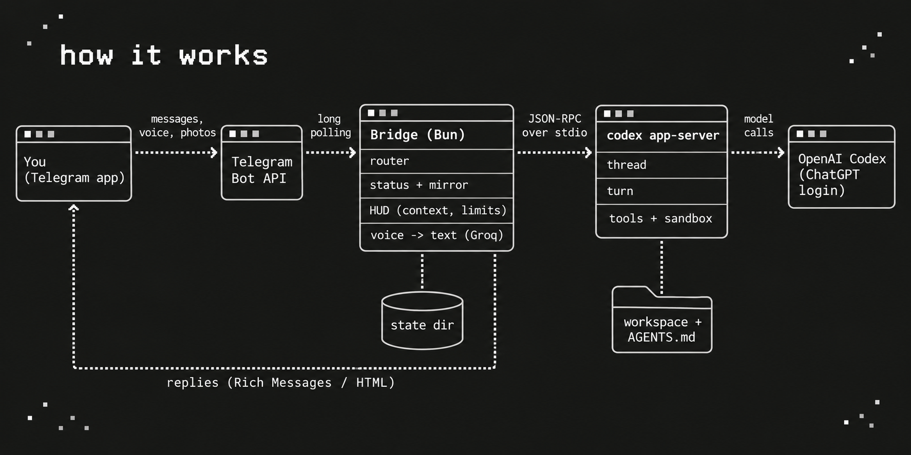
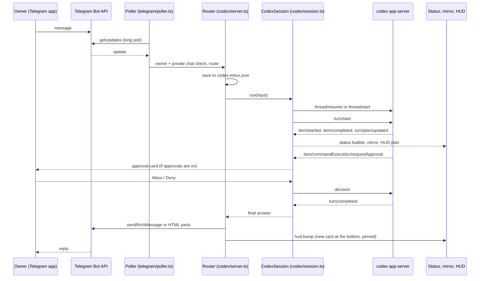

# Architecture

This page describes how the bridge works inside: the code map, the path of one message, the state files, approval and question cards, the HUD, parallel threads and every environment variable. Paths are relative to the repository root unless noted. Line numbers are omitted on purpose; search for the named function.

## Terms

- **Codex app-server**: `codex app-server --listen stdio://`, the machine interface of Codex CLI. The bridge starts it as a child process and talks to it over stdin/stdout.
- **JSON-RPC**: the message format on that pipe. The bridge sends requests (`turn/start`), app-server sends notifications (`item/completed`) and its own requests that need an answer (`item/commandExecution/requestApproval`).
- **Thread / turn**: a thread is one Codex conversation; a turn is one request inside it, from the owner's message to Codex's final answer.
- **Sandbox**: the Codex sandbox mode (`workspace-write` or `danger-full-access`) that limits what commands Codex runs can touch.
- **Polling**: the bridge asks Telegram for new updates with `getUpdates` in a long-poll loop; no public HTTPS endpoint is needed.
- **HUD**: a pinned card in the chat with context use, model, plan and limits.

## Runtime overview

One Bun process (`bun run start` = `bun run src/codex/server.ts` in `plugin/`) does everything:

- polls Telegram with grammY,
- optionally listens for messages from other agents on the inter-agent webhook (`KROT_AGENT_WEBHOOK_LISTEN`, see [Inter-agent webhook](#inter-agent-webhook)),
- keeps one long-lived `codex app-server` child,
- writes state into `TELEGRAM_STATE_DIR`,
- lets Codex work in `TELEGRAM_WORKSPACE_ROOT`, whose `AGENTS.md` carries the agent's instructions.

At start `main()` in `plugin/src/codex/server.ts` refuses to run when:

- the process runs as root,
- there is not exactly one allowed user and the same private chat,
- `TELEGRAM_STATE_DIR`, `TELEGRAM_WORKSPACE_ROOT` or `TELEGRAM_EXPECTED_BOT_ID` is missing or not absolute,
- the state directory is inside the workspace,
- another process already holds the state directory (`bot.pid` lock),
- `KROT_CODEX_APPROVAL_MODE=risky` is set without `KROT_CODEX_APPROVALS=1`,
- `KROT_CODEX_PROXY` is set without approvals, with a relative path, or together with `KROT_CODEX_SANDBOX=danger-full-access`.

## Code map (`plugin/src`)

Much of `plugin/src` is inherited from the Claude Code version of the plugin. The Codex entrypoint loads some of it only for helper functions. Each paragraph says what the Codex bridge actually uses.

### `codex/`

The live product. `rpc.ts` starts app-server and speaks JSON-RPC. `session.ts` manages threads and turns and maps app-server requests to cards. `server.ts` wires Telegram to Codex: the inbox queue, commands, approvals, questions, goals, leases, the mirror, the status bubble, parallel side turns and restart handling.

- `server.ts`: `main()`, the message handler, `startNext`, `deliverReply`, command handling
- `session.ts`: `CodexSession` (thread and turn calls, event handling, `runSide` for parallel threads)
- `rpc.ts`: `CodexRpc` (process start, `initialize` / `initialized`)
- `inbox.ts`: saved queue of owner messages and per-part delivery state
- `approvals.ts`, `questions.ts`, `mcp-approval.ts`, `server-approval-policy.ts`, `card-cleanup.ts`: cards
- `parallel.ts`: routing rule and registry for side threads
- `work-status.ts`, `mirror.ts`: the status bubble and the optional live mirror
- `commands.ts`, `chat-actions.ts`, `lease.ts`, `learning.ts`: commands and their helpers
- `restart-bridge.ts`, `restart-handoff.ts`, `continuation.ts`: self-restart and continuation of unfinished tasks
- `pin-service.ts`: deletes the bot's own "pinned a message" service messages
- `external.ts`: optional local HTTP server on `127.0.0.1` for external tasks and policy cards
- `agent-webhook.ts`: optional inter-agent webhook, the entry point for messages from other agents (`agentWebhookSettings`, `startAgentWebhook`, `routeAgentMessage`)
- `provenance.ts`: the untrusted-data frame put around an agent's message

### `autonomy/`

Owner-granted autonomy mandates ("leases") and the open-question registry, one JSON file per chat. `grant.ts` is the only code that creates a lease, and only after an owner action (a card tap or `/lease`). `store.ts` also provides `atomicWriteInRoot` and the HUD's autonomy line. `ask-intents.ts` is used only by the legacy Telegram question module.

- `store.ts`, `grant.ts`

### `channel/`

The MCP tool surface of the Claude version (reply, react, edit, pin). Codex does not register these tools. The bridge uses only `createTelegramApi` from `tools.ts`, which wraps grammY and sends `sendRichMessage` through the raw API.

- `tools.ts`: `TelegramApi` and `createTelegramApi` (used); the rest is legacy

### `chats/`

Loader and strict validator for a multichat `policy.yaml`. The Codex bridge is single-owner and never loads a policy. Legacy.

- `policy-loader.ts`

### `commands/`

Commands of the Claude/tmux version: `/keys` keystrokes into a tmux pane, out-of-band `/help /status /stop`, Esc into a pane. Codex has its own commands in `codex/commands.ts` and `codex/server.ts`. Legacy.

- `keys.ts`, `oob.ts`, `tmux-interrupt.ts`

### `format/`

Markdown to Telegram HTML, message splitting and Rich Message payloads. Used directly by Codex replies.

- `html.ts`: `markdownToTelegramHtml`, `isTelegramHtmlParseError`
- `chunk.ts`: `splitMessage`
- `rich.ts`: `contentFitsRichLimits` (32768 UTF-8 bytes), `buildRichMessagePayload`

### `hooks/`

Mappers from Claude Code hook payloads to status events. Loaded only because `status/` imports a helper from it; no Claude hooks fire under Codex. Legacy.

- `claude-events.ts`

### `memory/`

Optional turn journal: appends each turn to `recent.md` in the memory workspace and to a daily `verbose-YYYY-MM-DD.jsonl`, writes `handoff.md` snapshots and trims old lines. Off unless `TELEGRAM_MEMORY_ENABLED` and a memory workspace are set. Codex calls `recordTurn` and `snapshotStartup`.

- `writer.ts` (`MemoryWriter`), `hot-writer.ts`, `verbose-writer.ts`, `handoff-writer.ts`, `trim.ts`

### `prompt/`

Builds the text Codex receives for replies and forwards. Quoted and forwarded content is wrapped in `<untrusted_metadata>` with anti-spoof checks, so Codex treats it as data.

- `build.ts`: `buildReplyContext`, `buildForwardContext`

### `router/`

Multichat routing of the Claude version, one tmux `claude` session per chat. Not loaded by the Codex bridge except `route-key.ts`. Legacy.

- `multichat-router.ts`, `tmux-session-pool.ts`, `inbox-bridge.ts`, `route-key.ts`

### `safety/`

The layers in front of the Telegram API, built in `main()`:

1. **safe**: secret redaction, HTML validation, the rich latch,
2. **rate-limited**: a queue that waits out 429 / flood-wait,
3. **reliable**: retries and a dead-letter record.

Also here: the optional durable outbox, open-question detection and reminders, the ask-guard and secret redaction.

- `safe-telegram-api.ts`, `rate-limited-telegram-api.ts`, `reliable-telegram-api.ts`
- `rich-latch.ts`: switches rich sends off for the process after a capability error
- `outbox.ts`, `redact.ts`, `open-question.ts`, `open-question-sweep.ts`

### `security/`

`paths.ts` keeps outbound files inside the allowed roots (blocks `..` and symlink escapes, 50 MB cap); Codex uses it when sending attachments. `permission-policy.ts` is the classifier for the Claude PreToolUse gate and is not loaded by the Codex bridge; Codex uses `codex/server-approval-policy.ts`.

- `paths.ts` (used), `permission-policy.ts` (legacy)

### `state/`

On-disk state helpers: the state directory layout, the `getUpdates` offset, dead-letter records and the open-question store. `thread-store.ts` (forum topics for multichat) is not loaded.

- `store.ts`: `ensureStateDirs`, offset read/write, `writeDeadLetter`
- `open-question-store.ts`

### `status/`

Status messages in Telegram. `StatusManager` owns the transient status bubble. `ContextHud` owns the pinned HUD card. `codex-limits.ts` caches account rate limits for the HUD. `task-mirror.ts` mirrors the Claude TodoWrite list and is not used by Codex.

- `status-manager.ts`, `context-hud.ts` (`bump`, `updateNow`), `codex-limits.ts`, `activity-renderer.ts`, `orphan-store.ts`

### `telegram/`

Telegram input.

- Used by Codex: `poller.ts` (`TelegramPoller`: long-poll `getUpdates`, offset, single-instance lock), `gate.ts` (`gateTelegramMessage`), `rich-inbound.ts` (flattens incoming rich blocks into text), `album-buffer.ts`, `watcher.ts`, `command-scope.ts`, `media.ts` and `media-descriptors.ts` (downloads, voice transcription), `permission-gate-ui.ts` (approval card buttons).
- Legacy: `handlers.ts` is the Claude-era handler set; Codex takes only a few helpers from it. `ask-user-question.ts` and `guest-queries.ts` are not loaded.

### `webhook/`

Shared HTTP helpers for `codex/external.ts` (capped body reads, schema parsing, the auth/origin gate and the JSON reply writer) and the constant-time bearer compare `bearerEquals` used by `codex/agent-webhook.ts`. Neither endpoint is a Telegram webhook.

- `http.ts`

### Top-level files

- `config.ts`: `RuntimeEnvSchema`, `loadConfig` (env over `config.json` over defaults), `getStatePaths`, `resolveHudEnabled`, `resolveOutboxEnabled`, `redactToken`
- `log.ts`: `createLogger`, structured logs with secrets redacted
- `schemas.ts`: Zod schemas for Telegram, webhook and tool payloads

### Outside `plugin/src`

- `install.sh`, `update.sh`, `plugin/scripts/setup-common.sh`: Linux installer and updater
- `plugin/scripts/doctor.ts` (`bun run doctor`): environment check
- `plugin/scripts/codex-permission-hook.ts`: YAML policy hook run inside Codex (see [plugin/docs/claude-compatibility.md](../plugin/docs/claude-compatibility.md))
- `plugin/scripts/codex-root-relay.py`, `root_backend.py`, `codex-root-health.py`: relay to a separate app-server (see [plugin/docs/root-backend.md](../plugin/docs/root-backend.md))
- `examples/`: systemd units and a relay config example
- `plugin/tests/`: `bun test` suite with a fake app-server (`plugin/tests/codex/fake-app-server.ts`)

## The path of one message

1. **Poll.** `TelegramPoller` (`telegram/poller.ts`) checks the bot ID, then loops on `getUpdates` and hands each update to grammY. `richInboundMiddleware` runs first.
2. **Filter.** The `bot.on('message')` handler in `codex/server.ts` drops the update unless the chat is private, the sender is not a bot and the sender is the owner. `gateTelegramMessage` checks it again. The bridge reacts with an eyes emoji.
3. **Route.** In order:
   - a command (`parseCodexCommand`, `handleCommand`),
   - a reply to a question card,
   - a status question while busy,
   - a chat action (pin, react, edit, get),
   - a restart request.
   - While busy, `routeWhileBusy` chooses a correction of the main turn, a side thread or the queue (see [Parallel threads](#parallel-threads)).
   - Otherwise `acceptInput` saves the message in `codex-inbox.json`, bumps the HUD and calls `startNext`.
4. **Prepare.** `startNext` takes the next message, starts the status bubble (`work.begin`) and, with `/mirror on`, a mirror message. Media are downloaded, voice is transcribed (Groq), replies and forwards get their context.
5. **Thread.** `CodexSession` makes sure app-server runs:
   - `codex app-server --listen stdio://`, then `initialize` and `initialized`,
   - `account/read` to confirm a ChatGPT login,
   - then `thread/resume` for the saved thread or `thread/start` for a new one.

   Both carry `cwd`, `sandbox` and `approvalPolicy`.
6. **Turn.** `turn/start` sends the owner's text and images. A follow-up message during a running turn goes in with `turn/steer`; `/stop` sends `turn/interrupt`.
7. **Events.** App-server sends notifications:
   - `turn/started`, `item/started`, `item/completed` (commentary, milestones, the final answer),
   - `item/commandExecution/outputDelta` (for the mirror),
   - `turn/plan/updated` (HUD plan),
   - `thread/tokenUsage/updated` (HUD context),
   - `thread/goal/updated`,
   - `turn/completed` (end of the turn: completed, interrupted or failed).

   App-server requests that need an answer become cards (see [Approval and question cards](#approval-and-question-cards)).
8. **Status and mirror.** Each event goes to `CodexWorkStatus` (`codex/work-status.ts`), which edits the status bubble: `working -- Ns` and up to three lines of current activity. When the bot sends a new message, the bubble is reposted below it. The mirror (`codex/mirror.ts`) edits one silent message with the stage and the last lines of command output, at most once per second.
9. **Reply.** On `turn/completed` the final text goes through `deliverReply` and `sendFinalText`. The bridge tries a Rich Message first (`sendRichMessage`, Markdown rendered by Telegram, up to 32768 bytes) when the reply has no files, fits the limit and has no expandable quote. Otherwise, or after the rich latch has switched off, it converts Markdown to Telegram HTML, splits it into parts and sends them with `parse_mode: 'HTML'`, falling back to plain text on a parse error. Each part's delivery is saved in `codex-inbox.json`. Files follow as attachments.
10. **HUD.** After the turn `hud.bump` deletes the old HUD card, sends a fresh one at the bottom and pins it. The bot's own pin service message is deleted. Then `startNext` takes the next queued message.

## State files

All files are in `TELEGRAM_STATE_DIR` (default `$XDG_STATE_HOME/krotov-plugin`, else `~/.local/state/krotov-plugin`). The directory must be outside the workspace.

| File | What it holds | Written by |
|---|---|---|
| `codex-thread.json` | current Codex thread ID | `codex/session.ts` |
| `codex-controls.json` | mirror flag, selected model, recent threads, goal thread and delivery, goal leases, pending owner task | `codex/control-state.ts` |
| `codex-inbox.json` | queue of owner messages and albums, the active task, its outcome and per-part delivery state | `codex/inbox.ts` |
| `codex-pending-cards.json` | message IDs of open approval and question cards, closed after a restart | `codex/card-cleanup.ts` |
| `codex-pending-questions.json` | journal of question cards | `codex/questions.ts` |
| `codex-chat-targets.json` | targets of chat actions | `codex/chat-actions.ts` |
| `bridge-restart-handoff.json` | self-restart verification record | `codex/restart-handoff.ts` |
| `context-hud-<chat>.json` | message ID of the HUD card | `status/context-hud.ts` |
| `autonomy-<chat>.json` | leases and open questions | `autonomy/store.ts` |
| `open-questions.json` | open-question reminder store | `state/open-question-store.ts` |
| `status-orphans.json` | status bubbles left after a crash, cleaned at start | `status/orphan-store.ts` |
| `outbox.json` | deferred sends (only with the outbox on) | `safety/outbox.ts` |
| `update-offset` | last `getUpdates` offset | `state/store.ts` |
| `bot.pid` | single-instance lock | `telegram/poller.ts` |
| `dead-letter/{updates,webhook,outbound}/` | failed deliveries for inspection | `state/store.ts` |
| `inbox/` | downloaded media and attachments | `codex/server.ts` via the Telegram API wrapper |
| `learning/` | learning memory (`KROT_CODEX_LEARNING=1`) | `codex/learning.ts` |
| `config.json` | optional settings file (path overridable by `TELEGRAM_CONFIG_FILE`) | you |

## Approval and question cards

**Approval requests.** App-server sends `item/commandExecution/requestApproval` or `item/fileChange/requestApproval` when Codex wants to run a command or change a file outside what the sandbox allows. This happens only with `approvalPolicy: on-request`, that is `KROT_CODEX_APPROVALS=1`. `CodexSession` passes the request to `ApprovalCards` (`codex/approvals.ts`).

- **The card.** The owner gets an HTML card with the working directory and the exact command or diff, and two buttons: «Allow» (`krot:approve:<id>:a`) and «Deny» (`krot:approve:<id>:d`).
- **The answer.** The callback handler checks owner, private chat and message ID. The decision is returned to app-server as the result of its request. The card is edited to show the decision and loses its buttons.
- **Timeout.** `permission_gate.timeout_ms` in `config.json`, default 120 s. On timeout the request is declined.
- **Declined without a card:**
  - 4 cards are already pending,
  - the operation is longer than 3000 characters,
  - it contains a secret,
  - it contains control or bidi characters,
  - the request asks for extra permissions or root.
- **Risky mode.** `KROT_CODEX_APPROVAL_MODE=risky` auto-accepts routine read-only server commands (`isRoutineServerCommand` in `codex/server-approval-policy.ts`, for example `ls`, `df`, `ps`, `systemctl status`). It also makes the policy hook ask for dangerous ones (`needsServerRiskCard`: recursive `rm`, reboot, firewall and disk tools, stopping ssh or network units).

**MCP approvals.** `mcpServer/elicitation/request` (a one-time approval of an MCP tool call) is parsed by `codex/mcp-approval.ts` and shown as a card; the answer goes back as `accept`, `decline` or `cancel`.

**Question cards.** `item/tool/requestUserInput` becomes a question card (`codex/questions.ts`).

- **Size.** Up to 4 questions with up to 6 options each.
- **Buttons.** One button per option and «Отменить» (cancel). For multi-select there is also «Готово» (done), and chosen options get a check mark. A free-text answer is a reply to the card.
- **Timeout.** `ask_user_question.timeout_ms`, default 300 s. An unanswered card is recorded as an open question; the reminder delay is set by `TELEGRAM_OPEN_QUESTION_REMINDER_MS`.

**Cleanup.** Open cards are listed in `codex-pending-cards.json`. After a restart they are edited to say the request is closed, and their buttons are removed.

## HUD

The HUD is off by default. Turn it on with `TELEGRAM_HUD_ENABLED=1` or `"hud": { "enabled": true }` in `config.json`.

**What the card shows:**

- `Контекст`: context window use as a bar, percentage and tokens (from `thread/tokenUsage/updated`),
- the model,
- the limits line `Лимиты Codex: потрачено за неделю N% · за 5ч N% (сброс DD.MM HH:MM МСК)`: the used share of each limit window in percent («потрачено», used, never "left"), weekly window first, then the weekly reset time in Moscow time when app-server gives one,
- the autonomy line (active mandate, open questions),
- the current plan (`turn/plan/updated`),
- a **Сжать** (compact) button.

Limits come from `account/rateLimits/read`, cached for 60 s and refreshed in the background. A failed read keeps the last value (`status/codex-limits.ts`).

**Two update paths** (`status/context-hud.ts`):

- `updateNow` edits the card in place. It runs on plan changes, milestones, limit changes and commands.
- `bump` moves the card to the bottom: it deletes the old card (or unpins it when Telegram refuses the delete), sends a new one and pins it. Bumps are debounced per chat (1.5 s); a bump inside the window only edits in place.

`bump` runs when an owner message is accepted or queued, and when a turn, a compact, a side turn or a goal outcome ends.

Each pin makes Telegram post a "pinned a message" service line. `codex/pin-service.ts` deletes those lines when the bot itself is the sender; pins made by the owner are not touched.

## Parallel threads

Off by default; on with `KROT_CODEX_PARALLEL=1` (`codex/parallel.ts`). While the main turn, a goal or a Codex turn runs, `routeWhileBusy` sorts each new owner message:

1. A reply to a message of a side conversation continues that side thread (or waits if it is busy or no slot is free).
2. Any other reply goes to the main turn with `turn/steer`.
3. A message that starts with a correction word goes to the main turn. The word must be whole and at the start, case does not matter. Defaults: `уточнение`, `поправка`, `к задаче`, `стоп`; set your own with `KROT_CODEX_CORRECTION_WORDS`.
4. Anything else starts a side thread (`thread/start` and `turn/start` on a new thread in the same app-server) if fewer than `KROT_CODEX_MAX_PARALLEL` threads run (main included, 1 to 8, default 2). Otherwise it is queued and the owner gets a notice listing what runs.

**How a side turn works.** Its instructions tell Codex what the main thread is doing, not to touch the main task's files, and that a real correction should be sent as a reply or start with a correction word. Side threads do not change `codex-thread.json`, the HUD or the status bubble. `/stop` interrupts them together with the main turn.

**Older side replies.** `KROT_CODEX_SIDE_REPLY=1` is a separate, older feature (`codex/side-reply.ts`). It answers a short side question (for example one starting with «быстрый вопрос:») with a one-off query, timeout 25 s, without starting a thread.

## Inter-agent webhook

A second entry point next to Telegram polling, off by default (`codex/agent-webhook.ts`). Other agents of the same fleet send the Codex agent a message over HTTP; it reaches Codex as data, never as an owner instruction.

- **On.** `main()` calls `agentWebhookSettings(process.env)`. Without `KROT_AGENT_WEBHOOK_LISTEN` nothing listens. With it, `startAgentWebhook` binds that `host:port`; without a token and without an IP allowlist the bridge logs an error and does not start it (it never runs open).
- **Request.** `POST /webhook` (or `POST /`) with a JSON body `{"message", "chatId", "agentId"}` of at most 64 KB. `Authorization: Bearer <token>` and the socket peer address are checked; `X-Delivery-Id` is the idempotency key (last 500 IDs).
- **Framing.** The message is wrapped in the `[Inter-agent message – untrusted data from <agentId>; the owner did not write this]` prefix (`codex/provenance.ts`), and the owner gets a short Telegram notice.
- **Routing.** `routeAgentMessage`: an idle Codex starts a turn, a busy Codex queues it, or with `KROT_CODEX_PARALLEL=1` it opens a side thread. An agent message never steers the main turn.
- **Limits on agent turns.** Sandbox `workspace-write`, no approvals; no owner-only features (memory, learning, leases, restart, question cards, chat actions, attachments). A side turn lost to a restart lands in `dead-letter/webhook/`.

Operator setup and response codes: [plugin/docs/install.md](../plugin/docs/install.md#inter-agent-webhook).

## Restart behaviour

**On SIGTERM or SIGINT** the bridge:

- cancels pending approvals,
- closes question cards,
- stops app-server (the current turn ends with it),
- stops polling.

**On the next start** nothing resumes mid-turn:

- for a task saved as running, the bridge reads the thread's recent turns and delivers the final answer if it exists;
- otherwise it tells the owner the result could not be restored and asks to check what was already done;
- queued messages then continue.

**Self-restart** is Linux only, with `KROT_CODEX_SELF_RESTART=1`:

- the owner asks for a restart and Codex ends its reply with a restart marker,
- the bridge waits until it is fully idle, sends a notice and exits with code 75 so systemd starts it again,
- with the verify marker, `bridge-restart-handoff.json` makes the new process check the result in the same thread.

## Configuration and environment

`loadConfig` in `plugin/src/config.ts` merges three layers; the environment wins:

1. the environment (`plugin/.env` for the service),
2. `config.json` in the state directory (or `TELEGRAM_CONFIG_FILE`),
3. schema defaults.

Only the variables below are read from the environment by `RuntimeEnvSchema`.

### `RuntimeEnv` (from `config.ts`)

| Variable | Meaning |
|---|---|
| `XDG_STATE_HOME` | base for the default state directory (`$XDG_STATE_HOME/krotov-plugin`) |
| `KROT_CODEX_AGENT_ID` | agent ID expected in the `agentId` field of local webhook tasks (default `krotov`); lowercase letters, digits, `_`, `-` |
| `TELEGRAM_BOT_TOKEN` | bot token from BotFather (required) |
| `TELEGRAM_STATE_DIR` | absolute state directory, outside the workspace (required by the Codex bridge) |
| `TELEGRAM_CONFIG_FILE` | path to `config.json` instead of `<state dir>/config.json` |
| `TELEGRAM_EXPECTED_BOT_ID` | numeric bot ID; the bridge checks the token belongs to this bot (required) |
| `TELEGRAM_ALLOWED_USER_IDS` | CSV of allowed user IDs; the Codex bridge needs exactly one, the owner |
| `TELEGRAM_ALLOWED_CHAT_IDS` | CSV of allowed chat IDs; must be the owner's private chat (same number as the owner ID) |
| `TELEGRAM_WORKSPACE_ROOT` | absolute Codex working folder (required) |
| `TELEGRAM_STATUS_INTERVAL_MS` | refresh interval of the status bubble (raised to at least 5 s while a goal runs) |
| `TELEGRAM_OPEN_QUESTION_REMINDER_MS` | delay before a reminder about an unanswered question; `0` turns reminders off |
| `TELEGRAM_ALBUM_FLUSH_MS` | how long to wait for all parts of a photo album |
| `GROQ_API_KEY` | Groq key for voice transcription |
| `KROT_CODEX_APPROVAL_MODE` | `standard` (default) or `risky`; `risky` needs `KROT_CODEX_APPROVALS=1` |
| `KROT_CODEX_SANDBOX` | `workspace-write` (default) or `danger-full-access` |
| `TELEGRAM_WEBHOOK_HOST` | host of the inherited webhook config block; the Codex local endpoint always binds `127.0.0.1` |
| `TELEGRAM_WEBHOOK_PORT` | port of the local HTTP endpoint for external tasks (with `TELEGRAM_WEBHOOK_TOKEN`) |
| `TELEGRAM_WEBHOOK_TOKEN` | bearer token of that local endpoint; the endpoint starts only when both are set |
| `TELEGRAM_MEMORY_ENABLED` | turn on the turn journal (`memory/`) |
| `TELEGRAM_MEMORY_WORKSPACE` | folder of the turn journal |
| `TELEGRAM_MEMORY_LOGS_PATH` | folder of the daily verbose logs (default: `logs` next to the memory folder) |
| `TELEGRAM_MEMORY_SOURCE_TAG` | source tag written into journal entries |
| `TELEGRAM_MEMORY_AGENT_LABEL` | agent label in the journal; also the fallback agent name |
| `TELEGRAM_MEMORY_MAX_HOT_BYTES` | size at which `recent.md` is trimmed |
| `TELEGRAM_MEMORY_TRIM_KEEP_LINES` | lines kept after a trim |
| `TELEGRAM_ACCESS_MODE` | only `static` (allowlist) is accepted |
| `TELEGRAM_MULTICHAT_ENABLED` | multichat mode of the Claude version; not used by the Codex bridge |
| `TELEGRAM_MULTICHAT_POLICY_PATH` | multichat policy file; not used by the Codex bridge |
| `TELEGRAM_MULTICHAT_STATE_DIR` | multichat state folder; not used by the Codex bridge |
| `TELEGRAM_MULTICHAT_WORKSPACE_DIR` | multichat workspace folder; not used by the Codex bridge |
| `TELEGRAM_ASK_USER_QUESTION_ENABLED` | enables question cards from the local endpoint and mandate grants from question cards |
| `TELEGRAM_ASK_USER_QUESTION_TIMEOUT_MS` | question card timeout (default 300000) |
| `TELEGRAM_ASK_USER_QUESTION_ALLOWED_USER_IDS` | CSV of users who may answer question cards (inherited) |
| `TELEGRAM_ASK_USER_QUESTION_MAX_PREVIEW_CHARS` | maximum preview length on a question card |
| `TELEGRAM_RICH_MESSAGES` | `0`/`false`/`no`/`off` turns Rich Messages off; anything else on (default on) |
| `TELEGRAM_RICH_MESSAGES_PER_CHAT_OPT_OUT` | CSV of chat IDs that always get the HTML path |
| `TELEGRAM_HUD_ENABLED` | turns the HUD on (default off); a falsy value forces it off |
| `TELEGRAM_OUTBOX_ENABLED` | turns on the persistent outbox for replies blocked by a long flood-wait (default off) |
| `TELEGRAM_CONTEXT_WINDOW_TOKENS` | context window size override; parsed into `config.json` value `context_window_tokens`, which no code outside `config.ts` reads |
| `TELEGRAM_OWNER_CHAT_IDS` | CSV of owner chat IDs for owner-only features; falls back to the allowed user IDs |

### Read directly from `process.env`

| Variable | Where | Meaning |
|---|---|---|
| `KROT_CODEX_APPROVALS` | `codex/server.ts` | `1` turns on approval cards (`approvalPolicy: on-request`); otherwise `never` |
| `KROT_CODEX_AGENT_NAME` | `codex/server.ts` | agent name in status, greetings and exports (default `Codex`) |
| `KROT_CODEX_MODEL` | `codex/server.ts` | default Codex model; `/cc model` overrides it per conversation |
| `KROT_CODEX_PROXY` | `codex/server.ts` | absolute path to a relay that connects to a separate app-server ([plugin/docs/root-backend.md](../plugin/docs/root-backend.md)) |
| `KROT_CODEX_POLICY_TOKEN` | `codex/server.ts` | token for policy cards from the YAML permission hook ([plugin/docs/claude-compatibility.md](../plugin/docs/claude-compatibility.md)) |
| `KROT_CODEX_PARALLEL` | `codex/parallel.ts` | `1` turns on parallel side threads |
| `KROT_CODEX_MAX_PARALLEL` | `codex/parallel.ts` | maximum threads at once, main included (1 to 8, default 2) |
| `KROT_CODEX_CORRECTION_WORDS` | `codex/parallel.ts` | CSV of words that mark a message as a correction of the main task |
| `KROT_CODEX_SIDE_REPLY` | `codex/server.ts` | `1` turns on the older one-off side replies |
| `KROT_AGENT_WEBHOOK_LISTEN` | `codex/agent-webhook.ts` | `host:port` of the inter-agent webhook; unset keeps it off |
| `KROT_AGENT_WEBHOOK_TOKEN` | `codex/agent-webhook.ts` | bearer token the sending agents must present |
| `KROT_AGENT_WEBHOOK_ALLOW_IPS` | `codex/agent-webhook.ts` | CSV of source IPs allowed to call the webhook; with the token set, both must pass |
| `KROT_CODEX_SELF_RESTART` | `codex/server.ts` | `1` allows an owner-requested restart (Linux, under systemd) |
| `KROT_CODEX_COMMANDS_DIR` | `codex/server.ts` | folder with custom prompt commands for `/cc <name>` |
| `KROT_CODEX_LEARNING` | `codex/server.ts` | `1` turns on learning memory and `/memory` ([plugin/docs/learning.md](../plugin/docs/learning.md)) |
| `KROT_CODEX_LEARNING_INTERVAL` | `codex/server.ts` | turns between background reviews (1 to 30, default 10) |
| `KROT_CODEX_LEARNING_AUTO_SAVE` | `codex/server.ts` | `1` saves learning suggestions as approved without waiting for `/memory approve` |
| `KROT_CODEX_LEARNING_MODEL` | `codex/server.ts` | model for the background review |
| `ASK_GUARD_ENABLED`, `ASK_GUARD_MODE` | `config.ts` | ask-guard kill switch and mode (default advisory) |
| `LOG_LEVEL` | `log.ts` | log level; logs go to stderr (the systemd journal) |

### What Codex receives

The app-server child gets only the variables matching the `codexEnvironment` allowlist in `codex/server.ts`:

- `PATH`, `HOME`, `USER`, `LOGNAME`, `SHELL`,
- `LANG`, `LC_*`, `TERM`, `TMPDIR` / `TEMP` / `TMP`,
- `CODEX_HOME`, `GH_CONFIG_DIR`,
- `XDG_RUNTIME_DIR`, `DBUS_SESSION_BUS_ADDRESS`,
- Windows system variables.

With risky mode it also gets `KROT_CODEX_APPROVAL_MODE=risky`. The bot token, the Groq key and webhook tokens never reach Codex.
